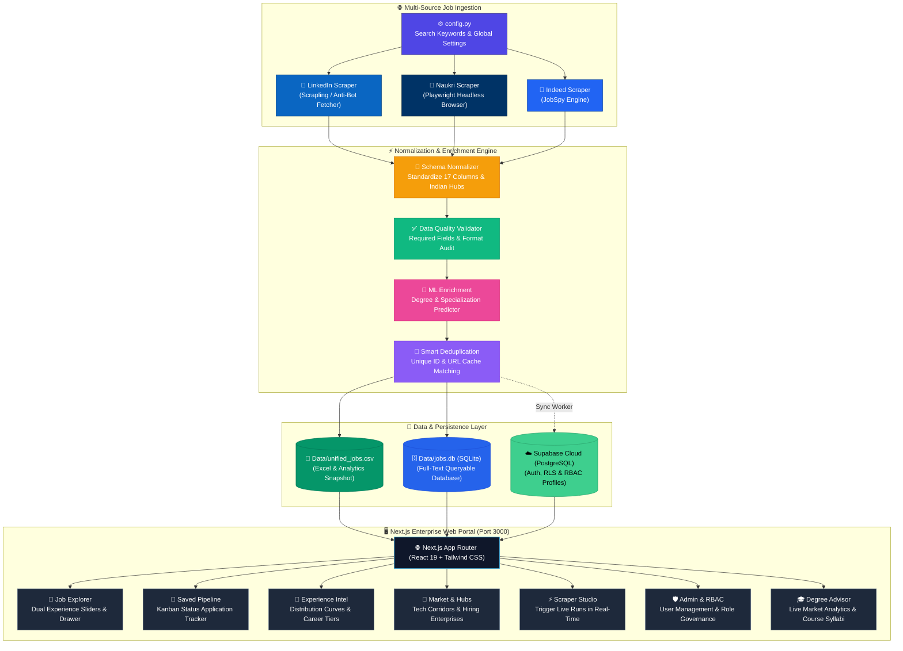
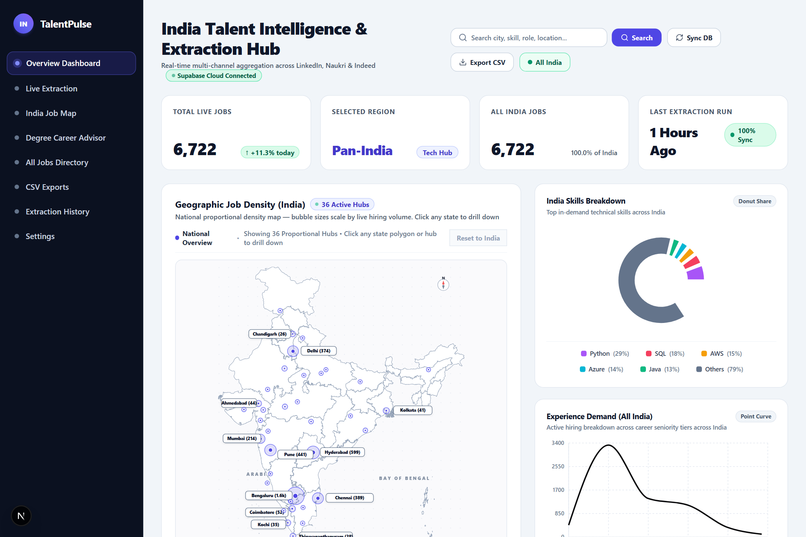
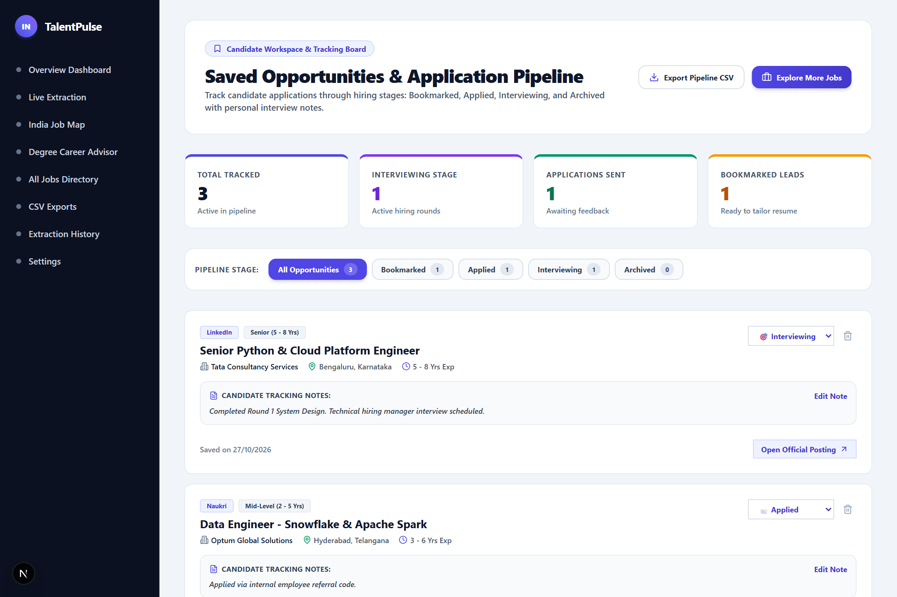
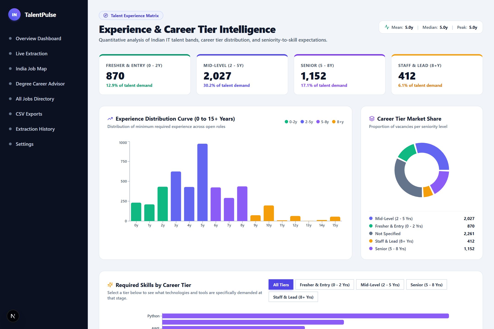
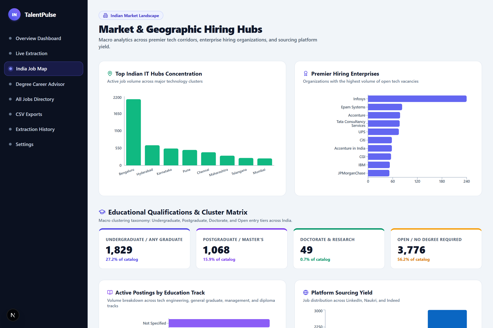
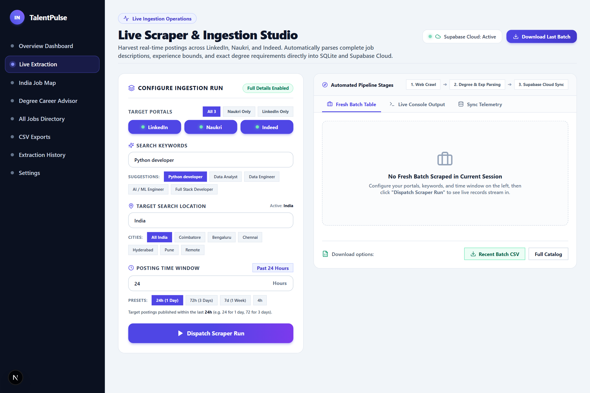
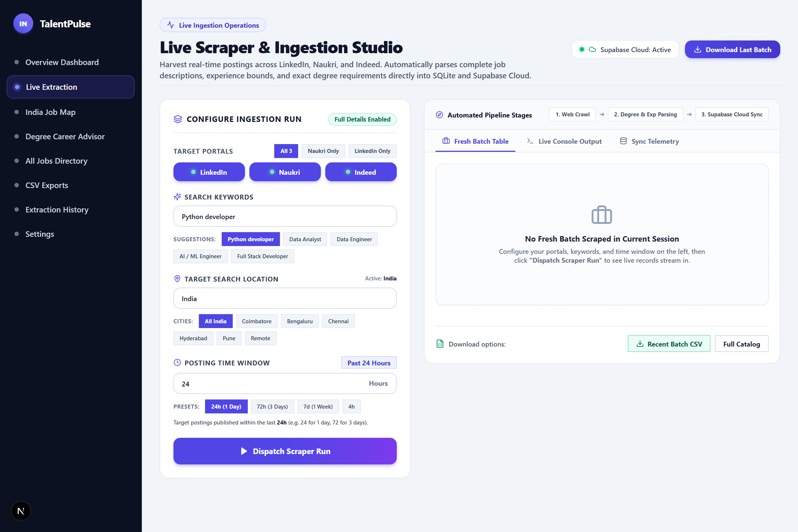
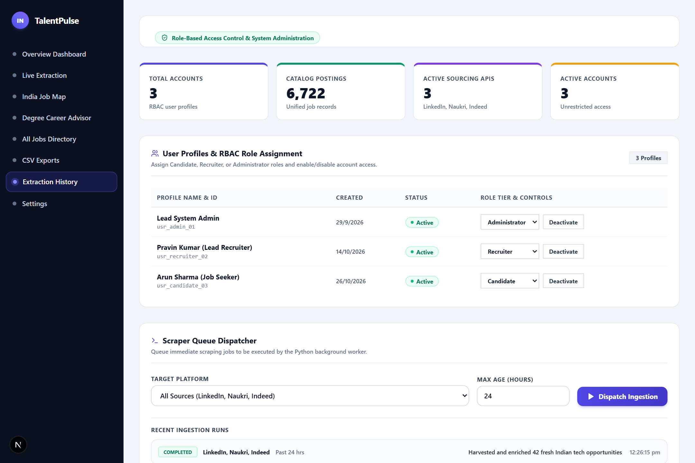
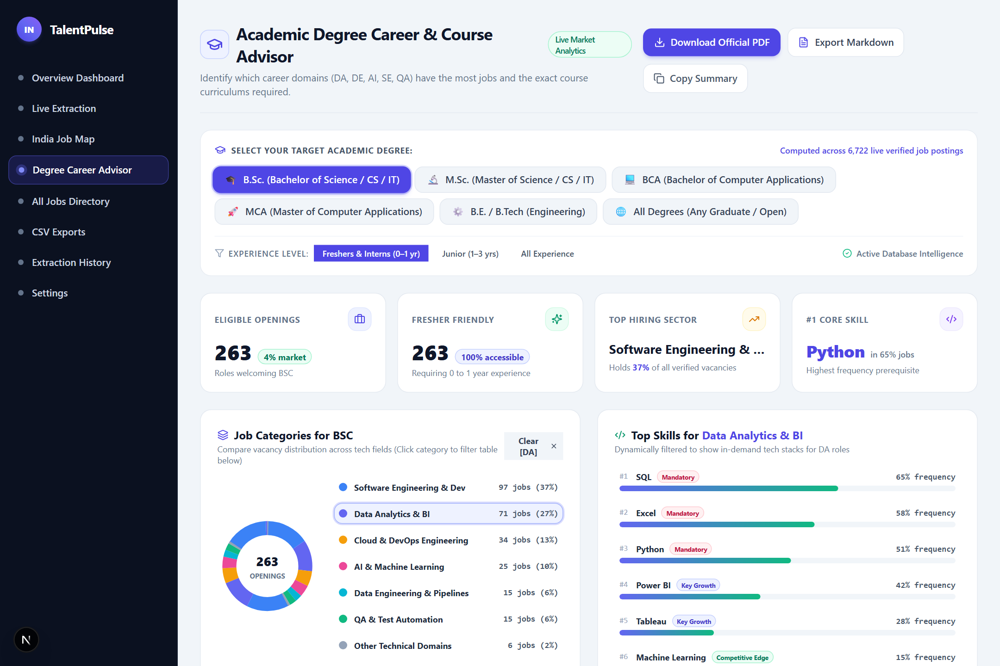

# 🇮🇳 Job Intelligence System & Enterprise Scraper Pipeline
### High-Performance Talent Analytics, ML Enrichment & Multi-Source Job Portal

A complete end-to-end talent intelligence platform that scrapes tech job postings from **LinkedIn**, **Naukri**, and **Indeed**, normalizes them into a unified 17-column schema, enriches missing qualifications with **Machine Learning**, eliminates duplicates, and serves the dataset through both local databases (**CSV**, **SQLite**) and a premium **Next.js Enterprise Web Dashboard**.

> **🎯 Primary Goal:** Keep one clean, automated, and searchable database of tech opportunities across India with real-time analytics, career tier intelligence, and interactive scraping controls.

---

## 📚 Table of Contents

- [🖼️ Architecture & Workflow (Diagram)](#️-architecture--workflow-diagram)
- [🚀 How to Start](#-how-to-start)
  - [1. Running the Python Scraper Pipeline](#1-running-the-python-scraper-pipeline)
  - [2. Starting the Next.js Web Dashboard](#2-starting-the-nextjs-web-dashboard)
- [🖥️ Web Application Workspaces (Screenshots)](#️-web-application-workspaces-screenshots)
  - [Screen 1: Job Explorer & Application Hub](#-screen-1-job-explorer--application-hub)
  - [Screen 2: Candidate Application Pipeline](#-screen-2-candidate-application-pipeline)
  - [Screen 3: Experience & Career Intelligence](#-screen-3-experience--career-intelligence)
  - [Screen 4: Market & Geographic Insights](#-screen-4-market--geographic-insights)
  - [Screen 5: Scraper Studio & Live Ingestion](#-screen-5-scraper-studio--live-ingestion)
  - [Screen 6: Admin Governance & RBAC Console](#-screen-6-admin-governance--rbac-console)
  - [Screen 7: Academic Degree Career & Course Advisor](#-screen-7-academic-degree-career--course-advisor)
- [✨ Key Features](#-key-features)
- [🗂️ Project Structure](#️-project-structure)
- [📊 Canonical 17-Column Schema](#-canonical-17-column-schema)
- [🧰 Requirements & Installation](#-requirements--installation)
- [🔑 Keyword Configuration](#-keyword-configuration)
- [🌱 Environment Variables](#-environment-variables)
- [🎛️ Pipeline Command-Line Options](#️-pipeline-command-line-options)
- [🧪 Testing & Data Quality Audit](#-testing--data-quality-audit)
- [🤖 Machine Learning Enrichment](#-machine-learning-enrichment)
- [🛠️ Troubleshooting](#️-troubleshooting)
- [⚖️ Responsible Scraping & License](#️-responsible-scraping--license)

---

## 🖼️ Architecture & Workflow (Diagram)



---

## 🚀 How to Start

### 1. Running the Python Scraper Pipeline

The scraper collects job postings from LinkedIn, Naukri, and Indeed, enriches them with ML, and stores them in `Data/unified_jobs.csv` and `Data/jobs.db`.

```powershell
# 1. Activate the Python virtual environment
.\.venv\Scripts\Activate.ps1

# 2. Run full scraper (all 3 sources)
python main.py --source all

# OR: Quick test run (up to 5 jobs per source)
python main.py --source all --linkedin-max-jobs 5 --indeed-max-jobs 5 --naukri-max-jobs 5

# OR: Specific source only
python main.py --source linkedin
python main.py --source naukri
python main.py --source indeed
```

---

### 2. Starting the Next.js Web Dashboard

The web portal provides an interactive dashboard with search filters, market graphs, and application management.

```powershell
# Option A: Run directly from root (convenience script)
npm run dev

# Option B: Run with prefix from root
npm run dev --prefix web

# Option C: From the web folder
cd web
npm run dev
```

Open your browser at **[http://localhost:3000](http://localhost:3000)**.

> To run the production build:
> ```powershell
> npm run build
> npm run start
> ```

---

## 🖥️ Web Application Workspaces (Screenshots)

The web dashboard is partitioned into **6 specialized workspaces** designed for job seekers, recruiters, and administrators:

---

### 💼 Screen 1: Job Explorer & Application Hub
**URL:** `/dashboard`  
The primary exploration workspace with precision dual min/max experience sliders, Indian IT tech hub filters (Bengaluru, Hyderabad, Pune, NCR, etc.), source selectors, keyword search, detailed job drawers, and direct application links.



- **Dual-Range Experience Sliders**: Filter by exact years of experience (e.g., `2.0` to `5.0` years).
- **Career Tier Presets**: One-click chips for Entry (0–2y), Mid (2–5y), Senior (5–8y), and Lead (8+y).
- **Interactive Job Drawer**: View full job descriptions, required skills, and qualification metadata.
- **Export to CSV**: Instant filtered export for offline recruiter tracking.

---

### 🔖 Screen 2: Candidate Application Pipeline
**URL:** `/saved-jobs`  
A personal candidate tracking pipeline to manage opportunities from discovery to interview.



- **Workflow Statuses**: Organize saved opportunities across `Saved`, `Applied`, `Interviewing`, and `Archived`.
- **Personal Notes**: Store company contact details, interview rounds, and follow-up reminders.
- **Direct Apply Links**: Jump straight to original source postings on LinkedIn, Naukri, or Indeed.

---

### 🎯 Screen 3: Experience & Career Intelligence
**URL:** `/dashboard/experience`  
Quantitative analytics on experience requirements across the Indian tech ecosystem.



- **Career Tier Market Share**: Pie chart distribution between Entry, Mid, Senior, and Leadership roles.
- **0–15y Experience Curve**: Identifies market concentration peaks and industry hiring sweet spots.
- **Skill Shift Analysis**: Discover how technical skill requirements evolve as seniority increases.

---

### 🏢 Screen 4: Market & Geographic Insights
**URL:** `/dashboard/market`  
Geographic corridor analysis and top hiring companies across India.



- **Top Indian IT Hubs**: Sourcing volume across Bengaluru, Hyderabad, Pune, Delhi NCR, Chennai, and Mumbai.
- **Premier Hiring Enterprises**: Leaderboard ranking companies with the highest active postings (TCS, Infosys, Optum, Citi, etc.).
- **Degree Distribution**: Market breakdown across B.Tech/B.E., MCA, Master's, and diplomas.

---

### ⚡ Screen 5: Scraper Studio & Live Ingestion
**URL:** `/dashboard/scraper`  
Trigger on-demand scraping directly from the web interface or terminal with granular control over platforms, freshness, and geographical scope.



- **Arbitrary Numeric Hours Input**: Directly input any freshness hour duration (e.g., `4`, `8`, `12`, `24`, `72` hours) without fixed button restrictions.
- **Geographic Location Targeting**: Filter by custom location (e.g., `Bengaluru`, `Hyderabad`, `Pune`, `Mumbai`, `Delhi NCR`, `Remote`, `India`) with 1-click quick selection chips.
- **Multi-Source Isolation & Selection**: Toggle any combination of LinkedIn, Naukri, and Indeed.
- **Live Output Terminal & Platform Breakdown**: Real-time log streaming, breakdown metrics per source platform, and an immediate preview table of newly extracted jobs with direct application links.
- **One-Click Batch Export**: Download the current batch of harvested postings directly as CSV.



---

### 🛡️ Screen 6: Admin Governance & RBAC Console
**URL:** `/admin`  
Enterprise administration, user role assignments, access control, and audit logs.



- **Role-Based Access Control (RBAC)**: Manage user roles (`admin`, `recruiter`, `user`).
- **User Governance**: Toggle user account status, view active sessions, and monitor usage.
- **Audit Logs**: Track data exports, scraper dispatch runs, and system modifications.

---

### 🎓 Screen 7: Academic Degree Career & Course Advisor
**URL:** `/dashboard/degree-advisor`  
An AI-assisted academic career guidance engine that maps candidate qualifications (**B.Sc.**, **M.Sc.**, **BCA**, **MCA**, **B.E./B.Tech**, or **Open Degrees**) to verified hiring volumes across India, identifies high-growth tech domains, and outputs targeted, topic-level learning curriculums with direct 2-page PDF report generation.



#### 🔍 What This Does:
- **🎯 Target Qualification Selection**: Toggle between `B.Sc.`, `M.Sc.`, `BCA`, `MCA`, `B.E. / B.Tech`, and `All Degrees (Any Graduate / Open)` to see exact market feasibility computed across thousands of live verified postings.
- **👶 Experience Granularity**: Instantly pivot between `Freshers & Interns (0–1y)`, `Junior (1–3y)`, and `All Experience` levels to isolate immediate entry-level graduate openings.
- **📊 Executive Market Feasibility KPIs**: View live statistics on:
  - 💼 **Eligible Openings**: Total vacancies welcoming this academic qualification.
  - ✨ **Fresher Accessibility**: Exact percentage of roles open to candidates with 0–1 year of experience.
  - 📈 **Top Hiring Sector**: The single technical domain commanding the highest hiring volume.
  - 💻 **#1 Core Technical Prerequisite**: The most frequently demanded skill across postings.
- **🍩 Visual Job Domain Distribution (Donut Chart)**: Real-time visual breakdown across 6 industry tech sectors:
  - 📊 **DA: Data Analytics & Business Intelligence**
  - 💻 **SE: Software Engineering & Full Stack Web Development**
  - 🤖 **AI: Artificial Intelligence & Machine Learning**
  - ☁️ **Cloud: Cloud Computing & DevOps Infrastructure**
  - ⚙️ **DE: Data Engineering & Big Data Pipelines**
  - 🛡️ **QA: Quality Assurance & Automated Software Testing**
- **⚡ Interactive Click-to-Filter on Domains**:
  - Clicking any sector (e.g. *Data Analytics*) dynamically filters the jobs table below to show **only** verified roles in that domain (powered by Title-First Classification to prevent cross-domain contamination).
  - Dynamically morphs the **Top In-Demand Skills** ranking to show only skills demanded within that specific career family.
  - Automatically reveals the **Targeted Course Curriculum** box customized for that track.
- **🛠️ Pure Technical Skills Ranking (Zero Soft Skills)**: Bar chart tracking real skill frequency demanded by hiring managers (Python, SQL, Power BI, Excel, AWS, Git, Java, Docker), with non-technical soft skills (*Communication, Teamwork*) cleanly filtered out.
- **📚 Targeted Modular Course Syllabi & Deep Topic Breakdowns**:
  - Structured module-by-module learning paths with exact sub-topics, industry libraries, and frameworks.
  - Realistic **Portfolio Capstone Projects** tailored for technical interviews.
  - Prerequisites and real-world market demand reality checks.
- **💼 Verified Live Openings Directory**: Real-time table showing role titles, companies, Pan-India flexible locations, single-line `Fresher (0y)` status, and direct portal application links.
- **📄 Direct 2-Page Executive PDF Dossier**:
  - 1-click client-side generation using `jspdf` and `jspdf-autotable` with **zero print dialogs**.
  - **Track 1**: Primary high-demand curriculum path with fully wrapped overview and modular topic grids.
  - **Track 2 (Dynamic Second Option)**: Automatically selects the **next highest hiring domain** in market volume as the candidate's secondary specialization option.
  - **Page 2 Live Openings Directory**: Curated directory of verified live positions matching the candidate's selected domain.
- **📋 1-Click Markdown Summary & Clipboard Export**: Export complete curriculum reports into clean GitHub-flavored markdown.

#### 💡 Why Use This (Real-World Value):
- **Bridge Academia & Industry**: Universities often teach outdated syllabi; this advisor reveals what companies are paying for *today*.
- **Strategic Career Choice**: Demonstrates that while *Data Analytics* and *Software Dev* offer the largest volume of immediate fresher openings (~50%+), *AI/GenAI* and *Cloud* provide the highest salary ceilings.
- **Zero Fluff**: Focuses purely on concrete technical topics (Window Functions, DAX, PyTorch, Docker) rather than vague advice.
- **Counselor & Recruiter Ready**: Export professional 2-page PDF dossiers to present to students, parents, or placement cells.

---

## ✨ Key Features

### 📥 1. Multi-Source Scraping
- **LinkedIn**: Clean search using Scrapling anti-bot fetcher, customizable freshness hours, and pagination.
- **Naukri**: High-fidelity browser automation via Playwright, detailed description parsing, and multi-page crawl.
- **Indeed**: Broad coverage via JobSpy with location-based filtering.
- **Centralized Keywords**: Define search queries once in `config.py` — shared across all three scrapers.

### 🔄 2. Data Normalization & Cleaning
- **Unified 17-Column Schema**: Every posting is structured into identical columns regardless of origin.
- **Indian IT Corridor Normalization**: Standardizes non-uniform city/state names into canonical tech hubs.
- **No Null Values**: Empty fields are cleanly populated with `"Not Specified"` to avoid blank records.

### 🤖 3. Machine Learning Enrichment
- Trained TF-IDF and Logistic Regression classifiers in `ml/models/`.
- Automatically predicts `degree_required` and `specialization_required` when omitted by recruiters.
- Safe inference: ML predictions never overwrite explicit data already present in job listings.

### 💾 4. Multi-Layer Storage
- **CSV (`Data/unified_jobs.csv`)**: Instant tabular view ready for Excel or Google Sheets.
- **SQLite (`Data/jobs.db`)**: High-speed SQL query database with unique constraint indices on `job_id`.
- **Supabase Cloud (PostgreSQL)**: Remote sync for user authentication, row-level security, and web portal persistence.

### 🎓 5. Academic Degree Career & Course Intelligence
- **Title-First Category Classification**: High-precision classification engine that categorizes postings into DA, SE, AI, Cloud, DE, and QA based on job titles first, preventing misleading classifications.
- **Dynamic Morphing Skills**: Live skill frequency ranking recalculates on the fly when switching career domains.
- **Soft Skill Isolation**: Distinguishes hard engineering tools from universal soft skills for razor-sharp learning focus.
- **Client-Side PDF Generation**: Fast, vectorized 2-page executive dossiers generated instantly in the browser without server roundtrips or printer dialogs.

### 📬 6. Automated Email & Alert Notifications
- **Automated Execution Digests**: Formatted summary emails sent via Gmail SMTP on completed runs, detailing new job counts, platform contributions, and top employers.
- **Instant Crash & Timeout Alerts**: Immediate notification triggers if scraping sessions encounter rate limits, network timeouts, or 0-job anomalies.
- **Zero External Dependencies**: Powered entirely by Python's built-in `smtplib` and `email.mime` modules.
- **Responsive Inline HTML**: Clean, cross-client email templates styled for instant reading on both desktop and mobile email clients.

---

## 🗂️ Project Structure

```
Job_Scraper/
│
├── main.py                    # Master CLI entrypoint for pipeline runs
├── config.py                  # Search keywords, locations, delays, and settings
├── database.py                # CSV-to-SQLite database sync engine
│
├── pipeline/                  # Core processing modules
│   ├── orchestrator.py        # Pipeline workflow coordinator
│   ├── normalizer.py          # Unified schema transformation & location cleaning
│   ├── schema.py              # 17-column data contract definition
│   ├── storage.py             # CSV and SQLite read/write operations
│   ├── enrichment.py          # Machine learning enrichment bridge
│   ├── live_scrape_runner.py  # Headless live scraper runner for the web API
│   ├── recency.py             # Time window filtering (1h - 30d)
│   ├── role_matcher.py        # Keyword and title classification
│   ├── notifier.py            # Automated Gmail SMTP execution & failure alert engine
│   ├── automated_domain_extractor.py # Sequential keyword slot rotation extractor
│   └── data_quality.py        # Automated schema and integrity audit
│
├── scrapers/                  # Ingestion scrapers
│   ├── linkedin/scraper.py    # LinkedIn scraper (Scrapling / Fetcher)
│   ├── naukri/scraper.py      # Naukri scraper (Playwright browser automation)
│   └── indeed/scraper.py      # Indeed scraper (JobSpy wrapper)
│
├── ml/                        # Machine learning subsystem
│   ├── ml_predictor.py        # Model loader and inference engine
│   ├── train_models.py        # Training script for classifiers
│   └── models/                # Serialized model checkpoints (.pkl)
│
├── web/                       # Next.js Enterprise Web Application
│   ├── app/                   # App Router pages (/dashboard, /degree-advisor, /admin)
│   │   ├── api/degree-report/ # REST endpoint for degree career intelligence
│   │   └── dashboard/degree-advisor/ # Degree Career Advisor dashboard page
│   ├── components/            # Reusable UI components, charts, and filter controls
│   ├── lib/                   # Data service, taxonomy, degree matching & PDF generator
│   │   ├── degree-matching.ts # Title-first classifier & course syllabi definitions
│   │   └── degree-pdf-generator.ts # Direct 2-page executive PDF dossier engine
│   ├── package.json           # Node.js dependencies (jspdf, jspdf-autotable, etc.)
│   ├── tailwind.config.ts     # Tailwind theme & color tokens
│   └── tsconfig.json          # TypeScript path aliases
│
├── Data/                      # Output directory (created after first run)
│   ├── unified_jobs.csv       # Unified dataset
│   ├── jobs.db                # SQLite database
│   └── seen_job_ids.json      # Deduplication cache
│
├── tests/                     # Test suites
│   ├── test_ui_flows.py       # Playwright end-to-end UI tests
│   └── screenshots/           # High-DPI walkthrough screenshots (Screens 1 to 7)
│
├── scripts/                   # Production & automated test scripts
│   └── test_degree_advisor_playwright.py # End-to-end Degree Advisor & PDF verification
│
├── requirements.txt           # Python dependencies
├── .env.example               # Environment variables template
└── README.md                  # Project documentation
```

---

## 📊 Canonical 17-Column Schema

| # | Column Name | Type | Description |
|:---:|---|---|---|
| 1 | `job_id` | String | Unique hash or platform-specific identifier |
| 2 | `source` | String | Sourcing origin (`LinkedIn`, `Naukri`, `Indeed`) |
| 3 | `title` | String | Standardized job title |
| 4 | `company` | String | Hiring organization name |
| 5 | `search_keyword` | String | Keyword query used during collection |
| 6 | `city` | String | Normalized Indian tech hub or city |
| 7 | `state` | String | Normalized state or region |
| 8 | `country` | String | Country name (`India`, etc.) |
| 9 | `min_experience_years` | Float | Minimum required experience in years |
| 10 | `max_experience_years` | Float | Maximum required experience in years |
| 11 | `experience_review` | String | Parsed experience classification text |
| 12 | `skills` | String | Comma-delimited extracted technical skills |
| 13 | `degree_required` | String | Minimum qualification (ML-enriched if missing) |
| 14 | `specialization_required` | String | Academic major (ML-enriched if missing) |
| 15 | `collected_at` | Timestamp | ISO 8601 scraping timestamp |
| 16 | `link` | String | Direct canonical URL to the posting |
| 17 | `full_description` | String | Full job description text |

---

## 🧰 Requirements & Installation

- **Python 3.10+**
- **Node.js 18+ & npm** (for the Web Dashboard)
- **Git**
- **Windows PowerShell** (or Linux/macOS terminal)

### Setup Steps:

```powershell
# 1. Clone repository
git clone https://github.com/Pravink1005/Job_Scraper.git
cd Job_Scraper

# 2. Setup Python Virtual Environment
python -m venv .venv
.\.venv\Scripts\Activate.ps1

# 3. Install Python Dependencies
python -m pip install --upgrade pip
pip install -r requirements.txt

# 4. Install Playwright Browser (Chromium)
playwright install chromium

# 5. Install Web Application Dependencies
cd web
npm install
cd ..
```

---

## 🔑 Keyword Configuration

All search keywords are maintained in a **single file** — [`config.py`](config.py):

```python
DEFAULT_SEARCH_KEYWORDS = [
    "data analyst",
    "python developer",
    "data scientist",
    "business analyst",
]
```

Any changes made here automatically propagate across LinkedIn, Naukri, and Indeed on the next scrape run.

---

## 🌱 Environment Variables

Create a `.env` file in the project root to customize paths and scraper limits:

```env
PIPELINE_OUTPUT_DIR=Data
LINKEDIN_LOCATION=India
LINKEDIN_MAX_JOBS_PER_KEYWORD=50
LINKEDIN_MAX_AGE_HOURS=24
NAUKRI_MAX_PAGES=5
NAUKRI_MAX_JOBS=50
NAUKRI_HEADLESS=true
INDEED_LOCATION=India
INDEED_MAX_JOBS_PER_KEYWORD=50
INDEED_MAX_AGE_HOURS=168
```

For the web application, optional Supabase credentials can be added to `web/.env.local`:
```env
NEXT_PUBLIC_SUPABASE_URL=https://your-project.supabase.co
NEXT_PUBLIC_SUPABASE_PUBLISHABLE_KEY=your-anon-key
```

---

## 🎛️ Pipeline Command-Line Options

| Option | Argument | Description |
|---|---|---|
| `--source` | `all`, `both`, `linkedin`, `naukri`, `indeed` | Sourcing platform to target (default: `all`) |
| `--output-dir` | `Data` | Directory for storing CSV, database, and cache |
| `--no-enrichment` | *(Flag)* | Disables the ML model inference step |
| `--rebuild-output` | *(Flag)* | Clears existing data before running |
| `--linkedin-max-jobs` | Integer (e.g. `10`) | Limit LinkedIn jobs collected per keyword |
| `--linkedin-max-age-hours` | Integer (e.g. `4`) | Collect LinkedIn postings from last N hours |
| `--naukri-max-pages` | Integer (e.g. `3`) | Max pages crawled on Naukri |
| `--naukri-max-jobs` | Integer (e.g. `20`) | Max postings scraped on Naukri |
| `--naukri-detail-pages` | *(Flag)* | Visit detail pages for deeper skill extraction |
| `--indeed-max-jobs` | Integer (e.g. `25`) | Limit Indeed postings collected per keyword |
| `--indeed-max-age-hours` | Integer (e.g. `24`) | Postings freshness cutoff for Indeed |

### Live Scraper Engine CLI (`pipeline/live_scrape_runner.py`)

Run targeted, on-demand live extractions with precise hours and location targeting:

```powershell
python pipeline/live_scrape_runner.py --sources "LinkedIn,Naukri,Indeed" --keywords "Python developer" --freshness 8 --location "Bengaluru"
```

| Argument | Example | Description |
|---|---|---|
| `--sources` | `"LinkedIn,Naukri,Indeed"` | Comma-separated list of target platforms |
| `--keywords` | `"Python developer"` | Search query / role title |
| `--freshness` | `4` or `8` | Cutoff age in hours (e.g. `4` for last 4 hours) |
| `--location` | `"Bengaluru"` or `"India"` | City or region for targeted geographical search |

---

## 🧪 Testing & Data Quality Audit

**Run the automated test suite:**
```powershell
python main.py --test
```

**Run End-to-End Web UI Tests (Playwright):**
```powershell
python tests/test_ui_flows.py
```

**Run the Data Quality Auditor:**
```powershell
python -m pipeline.data_quality
```
Verifies 17-column structural integrity, detects duplicate job IDs, checks required fields, and confirms SQLite $\leftrightarrow$ CSV consistency.

---

## 🤖 Machine Learning Enrichment

Located in [`ml/`](ml/), this subsystem classifies missing educational requirements using pre-trained scikit-learn models:
- **`ml/models/degree_model.pkl`**: Predicts educational tier (`B.Tech / B.E.`, `BCA / MCA`, `Master's`, etc.).
- **`ml/models/specialization_model.pkl`**: Predicts academic domain (`Computer Science`, `Data Science`, `IT`, etc.).

To evaluate or retrain the models:
```powershell
python ml/train_models.py
python ml/test_production_ml.py
```

---

## 🛠️ Troubleshooting

| Issue | Resolution |
|---|---|
| `Cannot find module 'package.json'` | Ensure you ran `npm install` inside the `web/` directory. |
| `playwright._impl._errors.Error: Executable doesn't exist` | Run `playwright install chromium` in your activated virtual environment. |
| LinkedIn returns 0 jobs | LinkedIn results depend on recency filters; broaden `--linkedin-max-age-hours 24`. |
| Naukri browser closes immediately | Verify `NAUKRI_HEADLESS=true` or run with `--naukri-headless true`. |
| CSV and SQLite records differ | Run `python database.py` to resynchronize SQLite with `unified_jobs.csv`. |

---

## ⚖️ Responsible Scraping & License

This software is provided for **educational, personal career tracking, and research purposes**. When scraping:
- Respect target website Terms of Service and `robots.txt`.
- Maintain modest concurrency and polite request intervals.
- Do not attempt to bypass CAPTCHAs, authentication barriers, or paywalls.

Distributed under the **MIT License**. See [LICENSE](LICENSE) for details.

---

## 👤 Author

**Pravin Kumar A.**  
- GitHub: [@Pravink1005](https://github.com/Pravink1005)  
- Repository: [Job_Scraper](https://github.com/Pravink1005/Job_Scraper)
