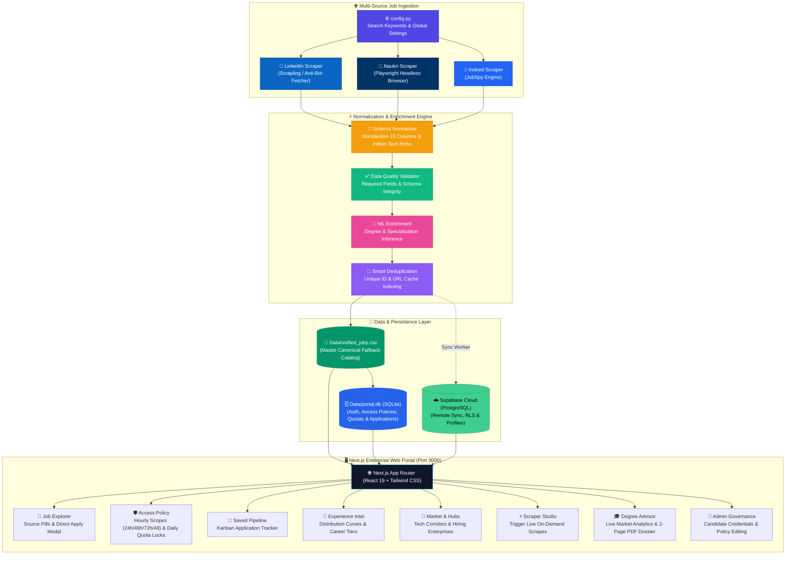

# 🇮🇳 Job Intelligence System & Enterprise Talent Portal
### High-Performance Multi-Source Scraper Pipeline, Candidate Governance & AI Talent Analytics

[](https://nextjs.org/)
[](https://react.dev/)
[](https://www.typescriptlang.org/)
[](https://www.python.org/)
[](https://tailwindcss.com/)
[](https://www.sqlite.org/)
[](https://playwright.dev/)
[](LICENSE)

A complete end-to-end talent intelligence platform and candidate portal that harvests tech job postings across India from **LinkedIn**, **Naukri**, and **Indeed**, normalizes them into a unified 15-column canonical schema, enriches educational requirements using **Machine Learning**, eliminates duplicates, and serves the dataset through both local databases (**CSV**, **SQLite `portal.db`**) and a high-performance **Next.js Enterprise Web Portal**.

> **🎯 Primary Goal:** Keep one clean, automated, and searchable database of tech opportunities across India with real-time analytics, per-candidate access governance (hourly scopes & daily application quota locks), career tier intelligence, and interactive scraping controls.

---

## 📚 Table of Contents

- [🖼️ Architecture & Workflow (Diagram)](#️-architecture--workflow-diagram)
- [🚀 Quick Start Guide](#-quick-start-guide)
  - [1. Running the Python Scraper Pipeline](#1-running-the-python-scraper-pipeline)
  - [2. Starting the Next.js Web Dashboard](#2-starting-the-nextjs-web-dashboard)
  - [3. Running the Scraper Daemon](#3-running-the-scraper-daemon)
- [🖥️ Enterprise Web Application Workspaces](#️-enterprise-web-application-workspaces)
  - [Workspace 1: Candidate Job Explorer & Application Hub](#-workspace-1-candidate-job-explorer--application-hub)
  - [Workspace 2: Candidate Access Policy & Quota Governance](#-workspace-2-candidate-access-policy--quota-governance)
  - [Workspace 3: Candidate Application Pipeline](#-workspace-3-candidate-application-pipeline)
  - [Workspace 4: Experience & Career Intelligence](#-workspace-4-experience--career-intelligence)
  - [Workspace 5: Market & Geographic Insights](#-workspace-5-market--geographic-insights)
  - [Workspace 6: Scraper Studio & Live Ingestion](#-workspace-6-scraper-studio--live-ingestion)
  - [Workspace 7: Admin Governance & RBAC Console](#-workspace-7-admin-governance--rbac-console)
  - [Workspace 8: Academic Degree Career & Course Advisor](#-workspace-8-academic-degree-career--course-advisor)
- [✨ Key Features](#-key-features)
- [🗂️ Project Structure](#️-project-structure)
- [📊 Canonical 15-Column Schema](#-canonical-15-column-schema)
- [💾 Persistence & Database Architecture](#-persistence--database-architecture)
- [🧰 Requirements & Installation](#-requirements--installation)
- [🔑 Keyword Configuration](#-keyword-configuration)
- [🌱 Environment Variables](#-environment-variables)
- [🎛️ Pipeline Command-Line Options](#️-pipeline-command-line-options)
- [🧪 Testing & Data Quality Audit](#-testing--data-quality-audit)
- [🤖 Machine Learning Enrichment](#-machine-learning-enrichment)
- [🛠️ Troubleshooting](#️-troubleshooting)
- [⚖️ Responsible Scraping & License](#️-responsible-scraping--license)

---

## 🖼️ Architecture & Workflow (Diagram)



---

## 🚀 Quick Start Guide

### 1. Running the Python Scraper Pipeline

The scraper pipeline collects job postings from LinkedIn, Naukri, and Indeed, enriches missing qualifications with ML, and stores canonical results in `Data/unified_jobs.csv`.

```powershell
# 1. Activate the Python virtual environment
.\.venv\Scripts\Activate.ps1

# 2. Run full scraper (all 3 sources)
python main.py --source all

# OR: Quick test run (up to 5 jobs per source)
python main.py --source all --linkedin-max-jobs 5 --indeed-max-jobs 5 --naukri-max-jobs 5

# OR: Run a specific source only
python main.py --source linkedin
python main.py --source naukri
python main.py --source indeed
```

---

### 2. Starting the Next.js Web Dashboard

The web portal provides an interactive dashboard with search filters, real-time analytics, candidate workspaces, and administrative governance.

```powershell
# Option A: Run directly from root (convenience npm script)
npm run dev

# Option B: Run from the web folder
cd web
npm run dev
```

Open your browser at **[http://localhost:3000](http://localhost:3000)**.

To build and start the production server:
```powershell
cd web
npm run build
npm run start
```

---

### 3. Running the Scraper Daemon

To continuously harvest fresh opportunities in the background:
```powershell
.\start_scraper_daemon.bat
```

---

## 🖥️ Enterprise Web Application Workspaces

The web application is partitioned into **8 specialized workspaces** designed for candidates, recruiters, and platform administrators:

---

### 💼 Workspace 1: Candidate Job Explorer & Application Hub
**URL:** `/dashboard`

The primary discovery workspace for tech job seekers across India.

```
+----------------------------------------------------------------------------------------------------+
|  Welcome back, Candidate!                     [ Last 24h Openings ]    (o) Portal Live Sync Active |
+------------------------+------------------------+-------------------------+------------------------+
| TOTAL AVAILABLE JOBS   | TOTAL APPLIED JOBS     | ACTIVELY HIRING COS     | AVAILABLE CATEGORIES   |
| 268                    | 6                      | 75+                     | 6 Domains              |
| Active in 24h window   | Applications submitted | Direct Employers        | Python, Data, Java, AI |
+------------------------+------------------------+-------------------------+------------------------+
| [Q Search jobs by title, company, or skills... ]        [ All India Locations v ] [ All Categories v ]
| FILTER BY SOURCE:  (o) All Sources (268)   (*) LinkedIn (5,580+)   (*) Naukri (3,000+)   (*) Indeed (3,700+)
+----------------------------------------------------------------------------------------------------+
```

- **Interactive Metric Cards**: Real-time counts for *Total Available Jobs*, *Total Applied Jobs*, *Actively Hiring Companies* (unique hiring employers in the active time window), and *Available Categories*.
- **Quick Source Pills**: 1-click source filtering (`All Sources`, `LinkedIn`, `Naukri`, `Indeed`) with live volume indicators.
- **Direct "Apply Now" Workflow**:
  - Opens a clean application modal pre-filled with candidate name, email, and academic qualifications.
  - Allows entering an optional candidate note or portfolio/GitHub URL.
  - Submits the application record directly to `Data/portal.db`.
  - Automatically redirects the candidate to the original verified job link on LinkedIn, Naukri, or Indeed.
- **Career Tier Presets**: Filter immediately by Entry (0–2y), Mid (2–5y), Senior (5–8y), and Lead (8+y).
- **Dual-Range Experience Sliders**: Fine-tune required experience from 0 to 15+ years.

---

### 🛡️ Workspace 2: Candidate Access Policy & Quota Governance
**Location:** Integrated into candidate session and `/admin`

Granular administrative controls to govern data visibility and application volumes per candidate.

- **Configurable Time-Window Data Scopes**:
  - **Arbitrary Numeric Hours**: Administrators can grant candidates access to jobs from the last **`24`**, **`48`**, or **`72`** hours, or select **`All Data`** for unrestricted access.
  - Candidate dashboard automatically filters eligible opportunities to match their exact assigned hourly window.
- **Daily Application Quota Lock**:
  - Administrators set a daily application ceiling per candidate (e.g., maximum **10 applications per day**).
  - The system tracks applications submitted by each candidate within the current calendar day in `Data/portal.db`.
  - **Automatic Safety Lock**: Once the candidate reaches their daily limit (e.g., 10/10), the job explorer automatically locks with a clear alert notice, preventing unauthorized application submissions until the next day.
- **Live Per-Candidate Policy Editing**: Administrators can modify any registered candidate's data window and daily application limits in real-time from the Admin Governance console without server restarts.

---

### 🔖 Workspace 3: Candidate Application Pipeline
**URL:** `/saved-jobs`

A personal candidate tracking pipeline to organize opportunities from discovery to interview.

- **Workflow Statuses**: Move opportunities across `Saved`, `Applied`, `Interviewing`, and `Archived`.
- **Personal Notes**: Store company contact details, interview rounds, and follow-up reminders.
- **Direct Apply Links**: Jump straight to original source postings on LinkedIn, Naukri, or Indeed.

---

### 🎯 Workspace 4: Experience & Career Intelligence
**URL:** `/dashboard/experience`

Quantitative analytics on experience requirements across the Indian tech ecosystem.

- **Career Tier Market Share**: Distribution curves between Entry, Mid, Senior, and Leadership roles.
- **0–15y Experience Curve**: Identifies market concentration peaks and industry hiring sweet spots.
- **Skill Shift Analysis**: Discover how technical skill requirements evolve as seniority increases.

---

### 🏢 Workspace 5: Market & Geographic Insights
**URL:** `/dashboard/market`

Geographic corridor analysis and top hiring companies across India.

- **Top Indian IT Hubs**: Sourcing volume across Bengaluru, Hyderabad, Pune, Delhi NCR, Chennai, Mumbai, and Coimbatore.
- **Premier Hiring Enterprises**: Leaderboard ranking companies with the highest active postings.
- **Degree Distribution**: Market breakdown across B.Tech/B.E., MCA, Master's, and diplomas.

---

### ⚡ Workspace 6: Scraper Studio & Live Ingestion
**URL:** `/dashboard/scraper`

Trigger on-demand scraping directly from the web interface or terminal with granular control over platforms, freshness, and geographical scope.

- **Arbitrary Numeric Hours Input**: Directly input any freshness hour duration (e.g., `4`, `8`, `12`, `24`, `72` hours).
- **Geographic Location Targeting**: Filter by custom location (e.g., `Bengaluru`, `Hyderabad`, `Pune`, `Mumbai`, `Delhi NCR`, `Remote`, `India`).
- **Multi-Source Isolation**: Toggle any combination of LinkedIn, Naukri, and Indeed.
- **Live Output Terminal**: Real-time log streaming, breakdown metrics per source platform, and an immediate preview table of newly extracted jobs.
- **One-Click Batch Export**: Download the current batch of harvested postings directly as CSV.

---

### 🔐 Workspace 7: Admin Governance & RBAC Console
**URL:** `/admin`

Enterprise administration, user role assignments, access code generation, and candidate policy management.

- **Candidate Access Codes**: Generate and distribute registration access codes with preset policies.
- **Candidate Account Management**: View candidate credentials, email addresses, and verification statuses.
- **Access Policy Customization**: Adjust data scope hours (`24h`, `48h`, `72h`, `All`) and daily application limits per candidate.
- **Audit Logs**: Track data exports, scraper dispatch runs, and system modifications.

---

### 🎓 Workspace 8: Academic Degree Career & Course Advisor
**URL:** `/dashboard/degree-advisor`

An AI-assisted academic career guidance engine that maps candidate qualifications (**B.Sc.**, **M.Sc.**, **BCA**, **MCA**, **B.E./B.Tech**, or **Open Degrees**) to verified hiring volumes across India, identifies high-growth tech domains, and outputs targeted, topic-level learning curriculums with direct 2-page PDF report generation.

- **Target Qualification Selection**: Toggle between `B.Sc.`, `M.Sc.`, `BCA`, `MCA`, `B.E. / B.Tech`, and `All Degrees`.
- **Experience Granularity**: Pivot between `Freshers & Interns (0–1y)`, `Junior (1–3y)`, and `All Experience` levels.
- **6 Industry Tech Sectors**:
  - 📊 **DA**: Data Analytics & Business Intelligence
  - 💻 **SE**: Software Engineering & Full Stack Web Development
  - 🤖 **AI**: Artificial Intelligence & Machine Learning
  - ☁️ **Cloud**: Cloud Computing & DevOps Infrastructure
  - ⚙️ **DE**: Data Engineering & Big Data Pipelines
  - 🛡️ **QA**: Quality Assurance & Automated Software Testing
- **Pure Technical Skills Ranking (Zero Soft Skills)**: Bar chart tracking real skill frequency demanded by hiring managers (Python, SQL, Power BI, Excel, AWS, Git, Java, Docker), filtering out non-technical soft skills.
- **Direct 2-Page Executive PDF Dossier**:
  - 1-click client-side generation using `jspdf` and `jspdf-autotable` with **zero print dialogs**.
  - **Track 1**: Primary high-demand curriculum path with fully wrapped overview and modular topic grids.
  - **Track 2**: Secondary specialization track dynamically selected based on the next highest hiring volume.
  - **Page 2 Live Openings Directory**: Curated directory of verified live positions matching the candidate's selected domain.

---

## ✨ Key Features

### 📥 1. Multi-Source Scraping
- **LinkedIn**: Fast search using Scrapling anti-bot fetcher with automatic guest API detail enrichment (`/jobs-guest/jobs/api/jobPosting/<id>`) extracting full descriptions, required experience ranges, and skills without browser overhead.
- **Naukri**: High-fidelity browser automation via Playwright, detailed description parsing, and multi-page crawl.
- **Indeed**: Broad coverage via JobSpy with location-based filtering.
- **Centralized Keywords**: Define search queries once in `config.py` — shared across all three scrapers.

### 🔄 2. Data Normalization & Cleaning
- **Unified 15-Column Schema**: Every posting is structured into identical columns regardless of origin.
- **Indian IT Corridor Normalization**: Standardizes non-uniform city/state names into canonical tech hubs.
- **No Null Values**: Empty fields are cleanly populated with `"Not Specified"` to avoid blank records.

### 🤖 3. Machine Learning Enrichment
- Trained TF-IDF and Logistic Regression classifiers in `ml/models/`.
- Automatically predicts `degree_required` and `specialization_required` when omitted by recruiters.
- Safe inference: ML predictions never overwrite explicit data already present in job listings.

### 💾 4. Multi-Layer Storage
- **CSV (`Data/unified_jobs.csv`)**: Instant tabular view ready for Excel or Google Sheets.
- **SQLite (`Data/portal.db`)**: Active database managing candidate auth, policy hours, daily limits, and application logs.
- **Supabase Cloud (PostgreSQL)**: Remote sync for user authentication, row-level security, and web portal persistence.

### 📁 5. Date & Time-Partitioned CSV Data Archiving
- **Date-Wise Organization (`Data/Date/<YYYY-MM-DD>/`)**: Automatically segregates extracted batches by date in Indian Standard Time (IST).
- **Time-Stamped Run CSVs (`Jobs_<Domain>_<HHMMSS>.csv`)**: Every hourly extraction run produces an isolated, immutable CSV file named with the exact domain and extraction time.
- **Master Historical Log (`Data/extraction_history.csv`)**: Full audit record capturing extraction timestamps, domain, keywords, sources, duration, yield, and status.

---

## 🗂️ Project Structure

```
Job_Scraper/
│
├── main.py                    # Master CLI entrypoint for pipeline runs
├── config.py                  # Search keywords, locations, delays, and settings
├── database.py                # CSV-to-SQLite database sync engine
├── start_scraper_daemon.bat   # Windows daemon for background scraping
│
├── pipeline/                  # Core processing modules
│   ├── orchestrator.py        # Pipeline workflow coordinator
│   ├── normalizer.py          # Unified schema transformation & location cleaning
│   ├── schema.py              # 15-column data contract definition
│   ├── storage.py             # CSV read/write operations
│   ├── enrichment.py          # Machine learning enrichment bridge
│   ├── live_scrape_runner.py  # Headless live scraper runner for the web API
│   ├── recency.py             # Time window filtering (1h - 30d)
│   ├── role_matcher.py        # Keyword and title classification
│   ├── audit_logger.py        # Date & time-partitioned CSV tracking and audit logger
│   ├── automated_domain_extractor.py # Sequential keyword slot rotation extractor
│   └── data_quality.py        # Automated schema and integrity audit
│
├── scrapers/                  # Ingestion scrapers
│   ├── linkedin/scraper.py    # LinkedIn scraper (Scrapling / Fetcher)
│   ├── naukri/scraper.py      # Naukri scraper (Playwright browser automation)
│   └── indeed/scraper.py      # Indeed scraper (JobSpy wrapper)
│
├── ml/                        # Machine learning subsystem
│   ├── ml_predictor.py        # Model loader and inference engine
│   ├── train_models.py        # Training script for classifiers
│   └── models/                # Serialized model checkpoints (.pkl)
│
├── web/                       # Next.js Enterprise Web Application
│   ├── app/                   # App Router pages (/dashboard, /degree-advisor, /admin)
│   │   ├── api/portal/        # Candidate auth, access policies, and application APIs
│   │   ├── api/degree-report/ # REST endpoint for degree career intelligence
│   │   └── dashboard/         # Candidate Explorer & analytics pages
│   ├── components/            # Reusable UI components, modals, and governance panels
│   ├── lib/                   # Data service, portal SQLite DB, taxonomy & PDF generator
│   │   ├── portal-db.ts       # Candidate auth, hourly scope & daily limit enforcement
│   │   ├── data-service.ts    # Job dataset loader & source aggregator
│   │   ├── degree-matching.ts # Title-first classifier & course syllabi definitions
│   │   └── degree-pdf-generator.ts # Direct 2-page executive PDF dossier engine
│   ├── package.json           # Node.js dependencies
│   ├── tailwind.config.ts     # Tailwind theme & color tokens
│   └── tsconfig.json          # TypeScript path aliases
│
├── Data/                      # Output and database directory
│   ├── portal.db              # Active SQLite DB (auth, quotas, applications)
│   ├── unified_jobs.csv       # Unified master dataset
│   ├── latest_extracted_jobs.csv # Most recent extraction batch
│   ├── seen_job_ids.json      # Deduplication cache index
│   ├── extraction_history.csv # Extraction telemetry log
│   └── Date/                  # Historical date-partitioned CSV dumps
│
├── tests/                     # Test suites
│   ├── test_ui_flows.py       # Playwright end-to-end UI tests
│   ├── test_schema.py         # Schema validation tests
│   └── test_storage.py        # Storage layer tests
│
├── scripts/                   # Production verification scripts
├── requirements.txt           # Python dependencies
├── .env.example               # Environment variables template
└── README.md                  # Project documentation
```

---

## 📊 Canonical 15-Column Schema

| # | Column Name | Type | Description |
|:---:|---|---|---|
| 1 | `job_id` | String | Unique hash or platform-specific identifier |
| 2 | `source` | String | Sourcing origin (`LinkedIn`, `Naukri`, `Indeed`) |
| 3 | `title` | String | Standardized job title |
| 4 | `company` | String | Hiring organization name |
| 5 | `city` | String | Normalized Indian tech hub or city |
| 6 | `state` | String | Normalized state or region |
| 7 | `country` | String | Country name (`India`, etc.) |
| 8 | `min_experience_years` | Float | Minimum required experience in years |
| 9 | `max_experience_years` | Float | Maximum required experience in years |
| 10 | `skills` | String | Comma-delimited extracted technical skills |
| 11 | `degree_required` | String | Minimum qualification (ML-enriched if missing) |
| 12 | `specialization_required` | String | Academic major (ML-enriched if missing) |
| 13 | `collected_at` | Timestamp | ISO 8601 scraping timestamp |
| 14 | `link` | String | Direct canonical URL to original posting |
| 15 | `full_description` | String | Full job description text |

---

## 💾 Persistence & Database Architecture

The system uses a robust dual persistence strategy:

1. **`Data/portal.db` (SQLite)**:
   - `candidate_accounts`: Candidate registration, hashed passwords, contact info, and verification state.
   - `candidate_access_policies`: Granular access rules per candidate, including data scope hours (`24h`, `48h`, `72h`, `all`) and daily application limits.
   - `job_applications`: Audit log of every application submitted by candidates (job ID, title, company, notes, submission timestamp).
   - `admin_access_codes`: Access code pool generated by administrators for candidate onboarding.

2. **`Data/unified_jobs.csv`**:
   - Master 15-column deduplicated job catalog containing Pan-India opportunities collected from LinkedIn, Naukri, and Indeed.
   - Serves as the high-speed local fallback dataset for the Next.js portal when Supabase is in offline mode.

3. **Supabase Cloud (PostgreSQL)** *(Optional)*:
   - Remote database for distributed team sync, remote authentication, and centralized cloud backups.

---

## 🧰 Requirements & Installation

- **Python 3.10+**
- **Node.js 18+ & npm** (for the Web Dashboard)
- **Git**
- **Windows PowerShell** (or Linux/macOS terminal)

### Setup Steps:

```powershell
# 1. Clone repository
git clone https://github.com/Kokss28/Job_Scraper.git
cd Job_Scraper

# 2. Setup Python Virtual Environment
python -m venv .venv
.\.venv\Scripts\Activate.ps1

# 3. Install Python Dependencies
python -m pip install --upgrade pip
pip install -r requirements.txt

# 4. Install Playwright Browser (Chromium)
playwright install chromium

# 5. Install Web Application Dependencies
cd web
npm install
cd ..
```

---

## 🔑 Keyword Configuration

All search keywords are maintained in a **single file** — [`config.py`](config.py):

```python
DEFAULT_SEARCH_KEYWORDS = [
    "data analyst",
    "python developer",
    "data scientist",
    "business analyst",
]
```

Any changes made here automatically propagate across LinkedIn, Naukri, and Indeed on the next scrape run.

---

## 🌱 Environment Variables

Create a `.env` file in the project root to customize paths and scraper limits:

```env
PIPELINE_OUTPUT_DIR=Data
LINKEDIN_LOCATION=India
LINKEDIN_MAX_JOBS_PER_KEYWORD=50
LINKEDIN_MAX_AGE_HOURS=24
NAUKRI_MAX_PAGES=5
NAUKRI_MAX_JOBS=50
NAUKRI_HEADLESS=true
INDEED_LOCATION=India
INDEED_MAX_JOBS_PER_KEYWORD=50
INDEED_MAX_AGE_HOURS=168
```

For the web application, optional Supabase credentials can be added to `web/.env.local`:
```env
NEXT_PUBLIC_SUPABASE_URL=https://your-project.supabase.co
NEXT_PUBLIC_SUPABASE_PUBLISHABLE_KEY=your-anon-key
```

---

## 🎛️ Pipeline Command-Line Options

| Option | Argument | Description |
|---|---|---|
| `--source` | `all`, `both`, `linkedin`, `naukri`, `indeed` | Sourcing platform to target (default: `all`) |
| `--output-dir` | `Data` | Directory for storing CSV, database, and cache |
| `--no-enrichment` | *(Flag)* | Disables the ML model inference step |
| `--rebuild-output` | *(Flag)* | Clears existing data before running |
| `--linkedin-max-jobs` | Integer (e.g. `10`) | Limit LinkedIn jobs collected per keyword |
| `--linkedin-max-age-hours` | Integer (e.g. `4`) | Collect LinkedIn postings from last N hours |
| `--naukri-max-pages` | Integer (e.g. `3`) | Max pages crawled on Naukri |
| `--naukri-max-jobs` | Integer (e.g. `20`) | Max postings scraped on Naukri |
| `--naukri-detail-pages` | *(Flag)* | Visit detail pages for deeper skill extraction |
| `--indeed-max-jobs` | Integer (e.g. `25`) | Limit Indeed postings collected per keyword |
| `--indeed-max-age-hours` | Integer (e.g. `24`) | Postings freshness cutoff for Indeed |

### Live Scraper Engine CLI (`pipeline/live_scrape_runner.py`)

Run targeted, on-demand live extractions with precise hours and location targeting:

```powershell
python pipeline/live_scrape_runner.py --sources "LinkedIn,Naukri,Indeed" --keywords "Python developer" --freshness 8 --location "Bengaluru"
```

---

## 🧪 Testing & Data Quality Audit

**Run the automated test suite:**
```powershell
pytest tests/
```

**Run End-to-End Web UI Tests (Playwright):**
```powershell
python tests/test_ui_flows.py
```

**Run the Data Quality Auditor:**
```powershell
python -m pipeline.data_quality
```
Verifies 15-column structural integrity, detects duplicate job IDs, checks required fields, and confirms dataset consistency.

---

## 🤖 Machine Learning Enrichment

Located in [`ml/`](ml/), this subsystem classifies missing educational requirements using pre-trained scikit-learn models:
- **`ml/models/degree_model.pkl`**: Predicts educational tier (`B.Tech / B.E.`, `BCA / MCA`, `Master's`, etc.).
- **`ml/models/specialization_model.pkl`**: Predicts academic domain (`Computer Science`, `Data Science`, `IT`, etc.).

To evaluate or retrain the models:
```powershell
python ml/train_models.py
```

---

## 🛠️ Troubleshooting

| Issue | Resolution |
|---|---|
| `Cannot find module 'package.json'` | Ensure you ran `npm install` inside the `web/` directory. |
| `playwright._impl._errors.Error: Executable doesn't exist` | Run `playwright install chromium` in your activated virtual environment. |
| LinkedIn returns 0 jobs | LinkedIn results depend on recency filters; broaden `--linkedin-max-age-hours 24`. |
| Naukri browser closes immediately | Verify `NAUKRI_HEADLESS=true` or run with `--naukri-headless true`. |
| Candidate Application Locked | The candidate has reached their configured daily application quota. Adjust the limit in `/admin` if needed. |

---

## ⚖️ Responsible Scraping & License

This software is provided for **educational, personal career tracking, and research purposes**. When scraping:
- Respect target website Terms of Service and `robots.txt`.
- Maintain modest concurrency and polite request intervals.
- Do not attempt to bypass CAPTCHAs, authentication barriers, or paywalls.

Distributed under the **MIT License**. See [LICENSE](LICENSE) for details.

---

## 👤 Author

**Kokila M.**  
- GitHub: [@Kokss28](https://github.com/Kokss28)  
- Repository: [Job_Scraper](https://github.com/Kokss28/Job_Scraper)
